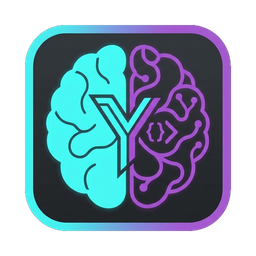
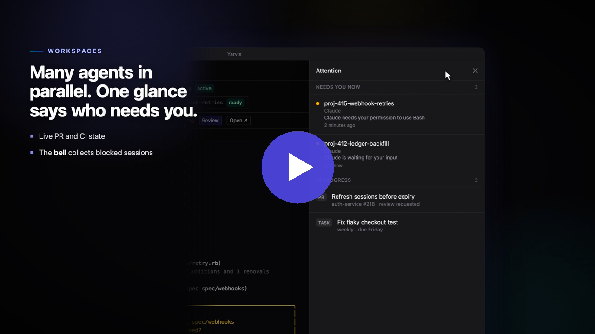

<p align="center">
  
</p>

<h1 align="center">Yarvis</h1>

<p align="center">
  Run your week with an assistant that can start the work.
</p>

<p align="center">
  <a href="https://bennettaur.github.io/yarvis/">Demo site</a> ·
  <a href="https://bennettaur.github.io/yarvis/video/">Showcase video</a> ·
  <a href="docs/getting-started.md">Getting started</a> ·
  <a href="https://github.com/bennettaur/yarvis/releases/tag/nightly">Nightly build</a>
</p>

A personal-assistant desktop app for macOS, built for developers who run
several coding agents at once.

You tell the Yarvis assistant what matters this week. It keeps track of your
projects, tasks and what you actually did. It starts work in isolated
workspaces with a Claude Code session on each, and it answers "where did I
leave off?" and "what should I do next?". Around it sit the tools a working
day needs: terminals, PR review with guided tours, your calendar with
full-screen meeting alarms, voice, a clipboard palette, and MCP (connect
servers to Yarvis, and let Claude Code use Yarvis's memory).

## Demo

<a href="https://bennettaur.github.io/yarvis/video/">
  
</a>

The 90-second reel shows a week with Yarvis: setting priorities, starting work,
parallel workspaces, PR review, alarms and the Friday wrap-up. Click the image
to play it, or download the
[MP4](https://github.com/bennettaur/yarvis/releases/download/showcase-video/yarvis-reel.mp4).
There is also a 3½-minute
[walkthrough](https://github.com/bennettaur/yarvis/releases/download/showcase-video/yarvis-walkthrough.mp4)
that covers every feature.

## Quick start

You need macOS, [Homebrew](https://brew.sh), and the Xcode Command Line Tools
(`xcode-select --install`). Setup takes about 30 minutes, most of it the first
Rust compile. If you already have Bun, Rust and Postgres with pgvector, skip to
step 2.

1. Install Bun and Rust (through [mise](https://mise.jdx.dev)), and
   PostgreSQL 17 with pgvector:

   ```bash
   brew install mise postgresql@17 pgvector
   brew services start postgresql@17
   echo 'eval "$(mise activate zsh)"' >> ~/.zshrc
   echo "export PATH=\"$(brew --prefix postgresql@17)/bin:\$PATH\"" >> ~/.zshrc
   exec zsh
   ```

2. Create the database:

   ```bash
   createdb yarvis
   psql -d yarvis -c 'CREATE EXTENSION IF NOT EXISTS vector;'
   ```

3. Clone the repo, install dependencies and start the app:

   ```bash
   git clone https://github.com/bennettaur/yarvis.git && cd yarvis
   mise install
   bun install
   bun run tauri dev
   ```

4. In the app, follow the setup guide that opens on first launch. To do it by
   hand, open **Settings → Credentials**, save the database URL
   `postgres://localhost:5432/yarvis`, and save one LLM provider key
   (Anthropic, Gemini or Cerebras). Then open **Chat** (Cmd+1) and say hello.

Prefer to be walked through it? Install
[Claude Code](https://claude.com/claude-code), clone the repo, run `claude` in
it, and type `/yarvis-setup`.

[Getting started](docs/getting-started.md) is the full guide: requirements,
optional features like GitHub, workspaces and voice, and troubleshooting.

## Features

| Feature | What it does |
| --- | --- |
| [The assistant](docs/features/assistant.md) | Plans your week with you, remembers what matters, tracks projects and priorities, starts and steers work |
| [Chat and Omni Chat](docs/features/quick-chat.md) | The Chat tab, and Omni Chat: summon the assistant over any screen with Control+Shift+Space |
| [Workspaces](docs/features/workspaces.md) | Multi-repo git worktrees, each with its own Claude Code session, diffs, self-review and stacked PRs |
| [Terminals](docs/features/terminals.md) | Tabbed, split terminals that keep running while you switch views |
| [PR review](docs/features/pr-review.md) | GitHub and Azure DevOps reviews with guided tours and per-line questions |
| [Issues and tasks](docs/features/issues-and-tasks.md) | GitHub issues, JIRA tickets and Azure Boards work items, your task list, and one-click "Start work" |
| [Omni view](docs/features/omni-view.md) | Describe a dashboard and get one, built from live widgets |
| [Voice](docs/features/voice.md) | Talk to the assistant and hear it answer, fully local if you like |
| [Calendar and alarms](docs/features/calendar-and-alarms.md) | Google Calendar, and full-screen meeting alarms |
| [Clipboard](docs/features/clipboard.md) | Copy buttons everywhere, and a palette of saved snippets and history |
| [MCP](docs/features/mcp.md) | Connect MCP servers to Yarvis, and give Claude Code sessions Yarvis's memory |
| [Browser](docs/features/browser.md) | Let the assistant read Slack, Gmail, Calendar and other pages open in your Chrome |
| [Telegram](docs/features/telegram.md) | Drive the assistant from your phone |
| [Scheduled jobs](docs/features/scheduled-jobs.md) | Run a prompt on a cron schedule |
| [Keyboard shortcuts](docs/features/keyboard-shortcuts.md) | Every shortcut in one place |

## More docs

- [Configuration](docs/configuration.md): where secrets and settings live,
  the `settings.json` reference, embeddings, 1Password, and environment
  variables. There is a starter [`settings.example.json`](docs/settings.example.json).
- [Running the local speech server](docs/voice-server.md): the local
  speech-to-text and text-to-speech server for voice.
- [Development](docs/development.md): architecture, commands, tests, running a
  second instance, nightly builds, and the project layout.
- [Showcase deck](docs/showcase/yarvis-showcase.html): a slide deck on the
  weekly workflow. Open it in a browser.
- [Showcase video](https://bennettaur.github.io/yarvis/video/): a 90-second reel and a
  full walkthrough, rendered with Remotion from the app's own components. The
  source is in [`video/`](video/README.md).
- [`AGENTS.md`](AGENTS.md): conventions for changing the code.
- [`ROADMAP.md`](ROADMAP.md): what's shipped and what's next.

## How it's built

A Tauri v2 app in three processes. A Rust core owns the window, terminals and
secrets. A React frontend draws the UI. A Bun sidecar owns Postgres
(with pgvector), the LLM calls and the background jobs. See
[Development](docs/development.md#architecture).
