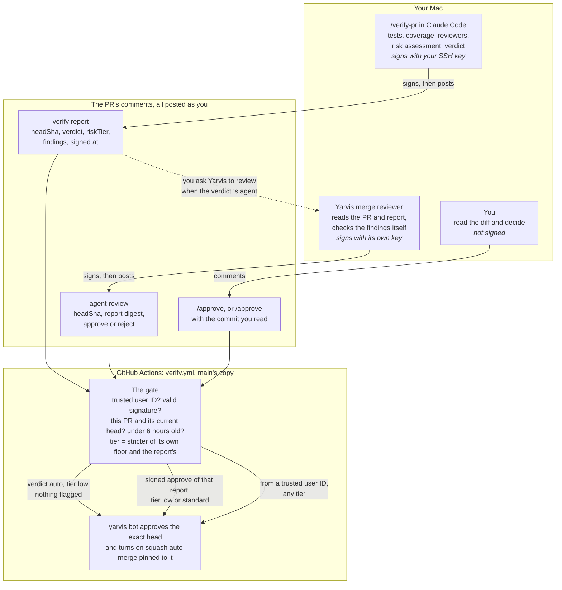

# How PRs merge through verification

Yarvis's verification layer lets a PR merge without you reading it, when that
is safe. Claude Code writes a signed report on the PR. A CI gate checks the
signature and decides whether the yarvis bot can approve it. When the report
asks for a second look, Yarvis's merge reviewer can give one, signed with its
own key.

This page explains how the pieces fit together. The settings, commands and
exact rules are in [Development](development.md#verifying-a-pr-for-merge).

## The flow



All three comments come from your GitHub account, so GitHub can't tell them
apart by author. The gate tells them apart by the signature on the first two.
A push after any of them changes the head commit, so the comment no longer
counts.

## Which path a PR takes

The report's verdict picks the path. The verdict can't be looser than the
risk tier, and the gate checks both again.

| Verdict | When | What happens |
| --- | --- | --- |
| `auto` | Tier low, no major or blocking findings, nothing flagged | The report alone is enough. The gate approves as soon as the signed report lands, if `VERIFY_MODE` is `enforce`. |
| `agent` | Tier standard, or a major finding or concern | Someone should read the diff first. You can ask Yarvis's merge reviewer to do it ("have the merge reviewer check bennettaur/yarvis#123"). Its signed approval merges the PR. A signed reject stands, and the PR waits for you. |
| `human` | Tier high, a blocker, or a failed check | Only you can merge it, by commenting `/approve`. The bot approves for you, because GitHub won't let you approve your own PR. |

## Why there are two signing keys

Claude Code and Yarvis both post with your GitHub token. So does anything
else that holds it: a stolen token, or a PR's test that runs under your `gh`
login. If the gate trusted any report comment from your account, any of those
could post a report with an `auto` verdict and get a PR merged.

A signature proves the comment was made on a machine holding a key that never
leaves it. The signed data names the repo, the PR, the exact commit and when
it was signed. So a signature can't be moved to another PR or a newer push,
or reused days later.

| | Your SSH signing key | The merge reviewer's key |
| --- | --- | --- |
| Lives in | 1Password, the same key that signs your commits | Yarvis, Settings → Credentials |
| Used by | `/verify-pr`, when `verify:report` posts | The `post_merge_review` tool, in Yarvis's sidecar |
| Signs as | `verify-pr`, namespace `yarvis-verify` | `yarvis-merge-reviewer`, namespace `yarvis-agent-review` |
| Can unlock | Any verdict, up to auto-merging a low-risk PR | Only a PR you already signed an `agent` report for, at that same commit |

The merge reviewer doesn't use your key, for two reasons:

- **Nobody is there to approve it.** The reviewer runs as a delegated agent
  inside the Yarvis app, so nobody is there to answer a 1Password prompt.
- **It shouldn't be able to do what your key does.** Your key can sign a whole
  report, including an `auto` verdict. The reviewer's key can only sign a yes
  or no on a report you signed. The gate ties each key to its own name and
  namespace, so the reviewer's key can never sign a report.

If the reviewer's key leaked, someone could only approve PRs that meet all of
these:

- they already have your signed `agent` report for their current commit;
- that report was signed in the last six hours;
- they aren't high risk.

## What each check stops

| If this happens | This stops it |
| --- | --- |
| Someone posts a fake report with your token | It has no valid signature from a key in `VERIFY_ALLOWED_SIGNERS`, so the gate ignores it. |
| A commit is pushed after the report | The signed `headSha` no longer matches. Every approval and the auto-merge are pinned to the commit that was checked. |
| An old signed report is posted again | A signature counts for six hours only, and only on the PR and commit it names. |
| The report understates the risk | The gate works out its own tier from the changed paths, size and risky added lines. The report can raise that tier but never lower it. |
| A PR's text tries to talk the reviewer into approving | The reviewer reads PR text as fenced data, and works on one PR only. The gate still refuses high-risk PRs and blockers, whatever the review says. |
| An outside contributor's PR | It never auto-merges, and its code never runs on your machine. `/approve` has to name the commit you read. |
| A change to the gate itself | The workflow always runs `main`'s copy, and those paths are always high risk. |

`/approve` isn't signed, so a stolen GitHub token could still use it.

## A typical PR

1. You run `/verify-pr` on your PR. 1Password asks to use your key, and the
   signed report is posted.
2. The gate sets the `Verification report` status. If the verdict is `auto`,
   the bot approves and auto-merge waits for the rest of CI.
3. If the verdict is `agent`, you ask Yarvis to have the merge reviewer check
   the PR. It posts a signed approve or reject, and the gate acts on an
   approve.
4. If the verdict is `human`, or you disagree with a reject, you read the PR
   and comment `/approve`.
5. If you push again, every earlier comment goes stale. Run `/verify-pr`
   again.

## Setting it up

These run from the Yarvis repo.

1. Print your report key's allowed-signers line, and set the repo variable to
   it. This replaces the variable's whole value, so only do it for the first
   key.

   ```bash
   bun run --silent verify:signers
   gh variable set VERIFY_ALLOWED_SIGNERS --body "$(bun run --silent verify:signers)"
   ```

2. Make the merge reviewer's key. This writes `merge-reviewer.key`, readable
   only by you, and prints its allowed-signers line.

   ```bash
   bun run verify:agent-key
   ```

3. In the repo's settings, add that printed line to `VERIFY_ALLOWED_SIGNERS`
   on its own line, under your key's line. Don't use `gh variable set` for
   this, because it would replace your key's line.
4. In Yarvis, open Settings → Credentials and paste the key file's contents
   into **Merge reviewer signing key**. Then delete `merge-reviewer.key`.
5. Check the other repo settings: `VERIFY_TRUSTED_USER_IDS`,
   `YARVIS_BOT_CLIENT_ID` and `YARVIS_BOT_PRIVATE_KEY`. See
   [Development](development.md#verifying-a-pr-for-merge) for what each one
   holds.
6. Leave `VERIFY_MODE` on `shadow` for a while. In shadow mode the gate sets
   the `Verification report` status but never approves on its own. When you
   trust it, make that status a required check in the `Protect Main` ruleset,
   then set `VERIFY_MODE` to `enforce`.
