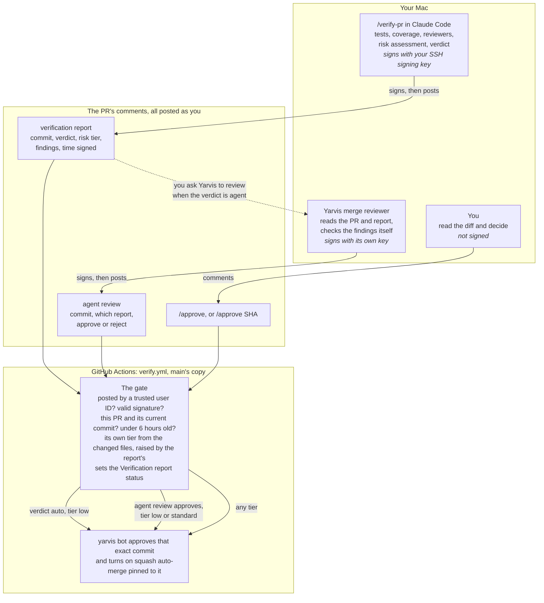

# How PRs merge through verification

Yarvis's verification layer lets a PR merge without you reading it, when that
is safe. Claude Code writes a signed report on the PR. A CI gate checks the
signature and decides whether the yarvis bot can approve it. When the report
asks for a second look, Yarvis's merge reviewer can give one. Its decision,
the agent review, is signed with its own key.

This page explains how the pieces fit together. The settings, commands and
exact rules are in [Development](development.md#verifying-a-pr-for-merge).

## The flow



All three comments come from your GitHub account, so GitHub can't tell them
apart by author. The gate tells the report and the agent review apart by
their signatures. A push after any of them changes the PR's head commit, so
the comment no longer counts.

The gate only reads comments from GitHub user IDs listed in
`VERIFY_TRUSTED_USER_IDS`, which is normally just yours. On the report and
agent review paths it also needs the PR's author to be a trusted user, the
PR not to be a draft, and `VERIFY_MODE` to be `enforce` (see
[Setting it up](#setting-it-up)). In the default `shadow` mode it only sets
the `Verification report` commit status.

## Which path a PR takes

The report's verdict picks the path. Verdicts go from loosest to strictest:
`auto`, `agent`, `human`. A PR's verdict can't be looser than its risk tier
allows, and the gate checks both again.

| Verdict | For example | What happens |
| --- | --- | --- |
| `auto` | Low risk, and every check passed: no finding of any severity, no check with a concern, enough of the changed lines covered by tests | The report alone is enough. The gate approves as soon as the signed report is posted. |
| `agent` | Standard risk, a major or minor finding, a check with a concern, or tests that miss many small breaking edits to the changed lines | Someone should read the diff first. You can ask Yarvis to have the merge reviewer do it ("have the merge reviewer check bennettaur/yarvis#123"). If its agent review approves, the gate approves too, unless the report has a blocking finding. If it rejects, the bot won't approve on that report, and the PR waits for you. |
| `human` | High risk, a blocking finding, a check that failed, or tests that fail on the PR | Only you can merge it, by commenting `/approve`. The bot approves for you, because GitHub won't let you approve your own PR. |

On an outside contributor's PR, the comment has to name the commit you read,
for example `/approve 3f5904a`.

## Why there are two signing keys

Claude Code and Yarvis both post with your GitHub token. So does anything
else that holds it: a stolen token, or a PR's test that runs under your `gh`
login. If the gate trusted any report comment from your account, any of those
could post a report with an `auto` verdict and get a PR merged.

A signature proves the comment was made on a machine holding a key that never
leaves it. The signed data names the repo, the PR, the exact commit and when
it was signed. So a signature can't be moved to another PR or a newer push,
or reused hours later.

Each signature also names who signed (the principal) and what it is for (the
namespace). The repo's `VERIFY_ALLOWED_SIGNERS` variable lists each allowed
public key, one line per key, with the principal and namespace it may sign
as.

| | Your SSH signing key | The merge reviewer's key |
| --- | --- | --- |
| Lives in | 1Password, the same key that signs your commits | Yarvis, Settings → Credentials |
| Used by | `/verify-pr`, when it posts the report | The merge reviewer, when it posts an agent review |
| Signs as | `verify-pr`, namespace `yarvis-verify` | `yarvis-merge-reviewer`, namespace `yarvis-agent-review` |
| Can unlock | Any verdict, up to auto-merging a low-risk PR | Only a PR you already signed an `agent` report for, at that same commit |

The merge reviewer doesn't use your SSH signing key, for two reasons:

- **Nobody is there to unlock 1Password.** The reviewer is a specialist
  agent that the Yarvis app runs on its own, so there is no one to answer a
  1Password prompt.
- **It shouldn't be able to do what your key does.** Your key can sign a whole
  report, including an `auto` verdict. The reviewer's key can only sign a yes
  or no on a report you signed. The gate ties each key to its own principal
  and namespace, so the reviewer's key can never sign a report.

A leaked reviewer key does nothing by itself, because the gate only reads
agent reviews posted by a trusted user ID. Someone would need your GitHub
token as well. Even then, they could only get the bot to approve a PR when
all of these hold:

- the PR already has your signed `agent` report for its current commit;
- that report and their agent review were both signed in the last six hours;
- the report has no blocking finding, and the PR isn't high risk;
- you are the PR's author, and it isn't a draft.

## What each check stops

| If this happens | This stops it |
| --- | --- |
| Someone posts a fake report with your token | It has no valid signature from a key in `VERIFY_ALLOWED_SIGNERS`, so the gate ignores it. |
| A commit is pushed after the report | The signed commit no longer matches. Every approval and the auto-merge are pinned to the commit that was checked. |
| An old signed report is posted again | A signature counts for six hours only, and only on the PR and commit it names. |
| The report understates the risk | The gate works out its own tier from the changed files: their paths, their size, and risky added lines. The report can raise that tier but never lower it. |
| A PR's text tries to talk the reviewer into approving | The reviewer is told to treat everything in the PR as data, never as instructions. Its tools can only read and post on the first PR it opens. The gate still refuses high-risk PRs and blocking findings, whatever the agent review says. |
| An outside contributor's PR | It never auto-merges. The `/verify-pr` skill never runs its code on your machine. `/approve` has to name the commit you read. |
| A change to the gate itself | The workflow always runs `main`'s copy, and the gate's own files are always high risk. |
| Someone uses your token to comment `/approve` | This isn't signed, so the gate can't stop it. Once `Verification report` is a required check, the PR still needs a signed report for its current commit before it can merge. |

## A typical PR

1. You run `/verify-pr` on your PR. 1Password may ask to use your SSH signing
   key, and the signed report is posted.
2. The gate sets the `Verification report` status. If the verdict is `auto`,
   the bot approves and auto-merge waits for the rest of CI.
3. If the verdict is `agent`, you ask Yarvis to have the merge reviewer check
   the PR. It posts a signed agent review, and the gate acts on an approve.
4. If the verdict is `human`, or you disagree with a reject, you read the PR
   and comment `/approve`.
5. If you push again, every earlier comment goes stale. Run `/verify-pr`
   again. After pushing fixes for what a report flagged,
   `/verify-pr <N> --recheck` re-verifies only that and the new commits.

## Setting it up

These run from the Yarvis repo.

1. Check the line for your SSH signing key, then set the repo variable to it.
   Do this once only: `gh variable set` replaces the variable's whole value.
   Step 3 adds the second key by hand.

   ```bash
   bun run --silent verify:signers
   gh variable set VERIFY_ALLOWED_SIGNERS --body "$(bun run --silent verify:signers)"
   ```

2. Make the merge reviewer's key. This writes `merge-reviewer.key`, readable
   only by you, and prints the key's line for `VERIFY_ALLOWED_SIGNERS`.

   ```bash
   bun run verify:agent-key
   ```

3. In the repo's settings, add that printed line to `VERIFY_ALLOWED_SIGNERS`
   on its own line, under your key's line.
4. In Yarvis, open Settings → Credentials and paste the key file's contents
   into **Merge reviewer signing key**. Then delete `merge-reviewer.key`.
5. Check the other repo settings: `VERIFY_TRUSTED_USER_IDS`,
   `YARVIS_BOT_CLIENT_ID` and `YARVIS_BOT_PRIVATE_KEY`. See
   [Development](development.md#verifying-a-pr-for-merge) for what each one
   holds.
6. Leave `VERIFY_MODE` on `shadow` for a while. In shadow mode the gate sets
   the `Verification report` status but never approves on a report or an
   agent review. When you trust it, make that status a required check in the
   `Protect Main` ruleset, then set `VERIFY_MODE` to `enforce`.
